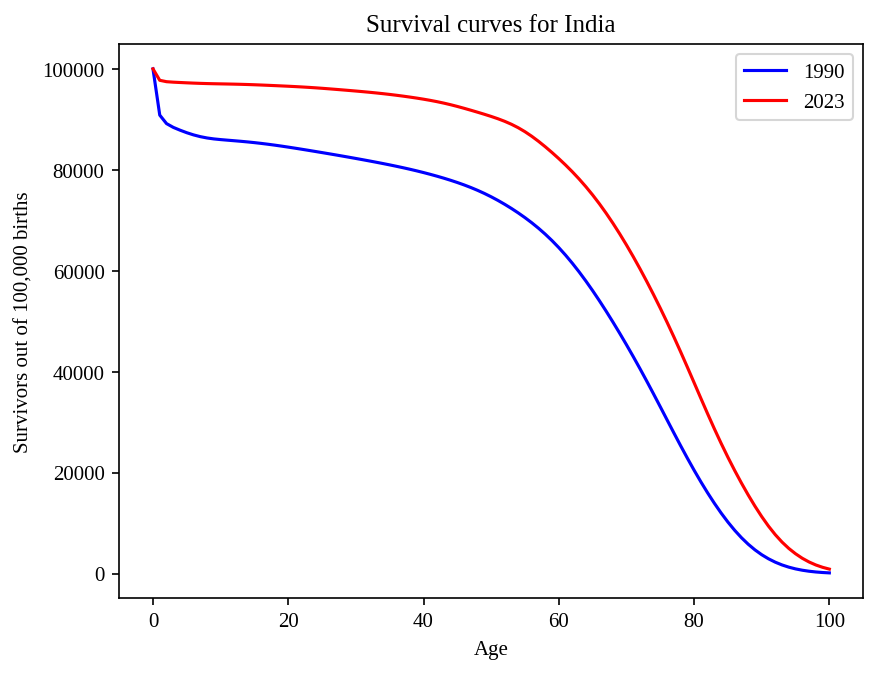
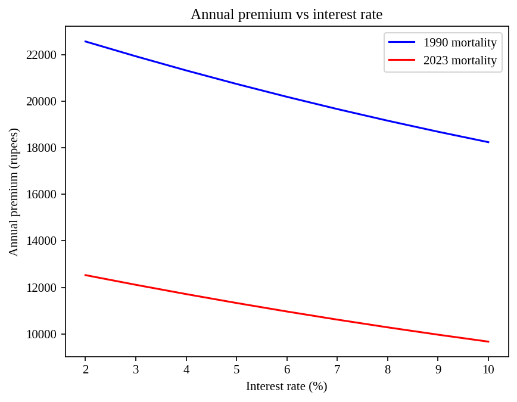

# How much should life insurance cost in India?

A simple actuarial model that prices a term life insurance policy from
real Indian mortality data, and compares 1990 with 2023.

## The question

What is the fair annual premium for a 30-year-old buying ₹50 lakh of life
cover for 20 years, and how has India's fall in mortality changed it?

## Method

1. **Data.** Single-age death probabilities (qx) for India, both sexes
   combined, from the UN World Population Prospects 2024.
2. **Life table.** From qx I built px = 1 − qx and the number surviving
   out of 100,000 births, using l(x+1) = l(x) · p(x). My table matches the
   UN's published lx to within 0.004 at every age.
3. **Pricing.** Using the equivalence principle, the premium P satisfies

       P × Σ v^k · l(x+k)/l(x)  =  S × Σ v^(k+1) · (l(x+k) − l(x+k+1))/l(x)

   where v = 1/(1+i), S is the sum assured, and the sums run over the 20
   policy years. The left side is the expected present value of premiums;
   the right side is the expected present value of payouts.

## Key results

Policy: ₹50 lakh cover, age 30, 20-year term, 6% interest.

| | 1990 mortality | 2023 mortality |
|---|---|---|
| Probability a 30-year-old dies within the year | 0.297% | 0.124% |
| Survivors to age 60, per 100,000 births | 64,588 | 82,220 |
| Fair annual premium | ₹20,193 | ₹10,963 |

The same cover costs 1.84 times as much under 1990 mortality. Under 2023
mortality, 5.26% of 30-year-olds die before age 50, and the expected
present value of the payout is ₹1,31,377.

### Survival curves

### Sensitivity to the interest rate

Raising the interest rate from 2% to 10% lowers the 2023 premium from
₹12,527 to ₹9,667, about 23%. The effect is mild because the interest
rate discounts both premiums and payouts.

### Sensitivity to age at purchase

.png)

| Age at purchase | 1990 | 2023 |
|---|---|---|
| 20 | ₹13,773 | ₹5,680 |
| 30 | ₹20,193 | ₹10,963 |
| 40 | ₹40,404 | ₹25,740 |
| 50 | ₹92,373 | ₹62,174 |
| 60 | ₹1,99,219 | ₹1,39,462 |

Age matters far more than the interest rate: a 50-year-old pays 5.7 times
what a 30-year-old pays. The gap between 1990 and 2023 is widest for
young adults (2.4 times at age 20, 1.4 times at age 60).

## Limitations

- **Pure premium only.** No expenses, commission, profit margin, tax or
  safety loading, so real premiums are higher.
- **Population mortality, not insured lives.** People who buy insurance
  are medically screened and tend to be healthier and wealthier than the
  national average, so insurers use different tables.
- **No gender split.** Both sexes are combined; real pricing separates them.
- **National averages only.** No allowance for state, income, occupation,
  smoking or health.
- **Period life table.** The model assumes one year's death rates apply
  for the whole 20 years. Future mortality improvement is ignored.
- **Data quality.** India's death registration is incomplete, so the UN
  figures are partly model-based estimates.
- **Simplified timing.** Payouts are assumed to be made at the end of the
  year of death, and premiums annually in advance. Policy lapses are ignored.
- **The 1990 figure is a comparison, not a historical price.** It uses
  today's ₹50 lakh and 6% with 1990 death rates.

## Files

- The `.ipynb` notebook: the full analysis (opens in Google Colab)
- `india_life_table_1990_2023.csv`: the data used
- `*.png`: figures

## Data source

United Nations, Department of Economic and Social Affairs, Population
Division (2024). World Population Prospects 2024. The file
`WPP2024_Life_Table_Complete_Medium_Both_1950-2023.csv.gz` was downloaded
from a public mirror of the UN's files on Hugging Face (yuiseki/un-wpp).

## Tools

Python, pandas, NumPy, matplotlib.
